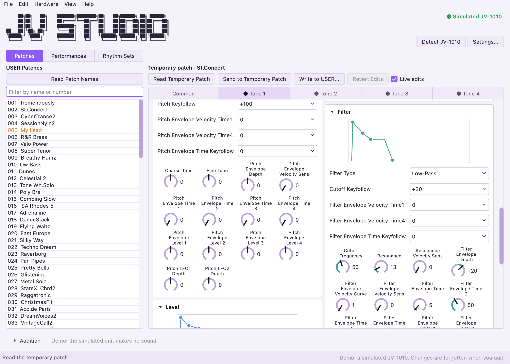
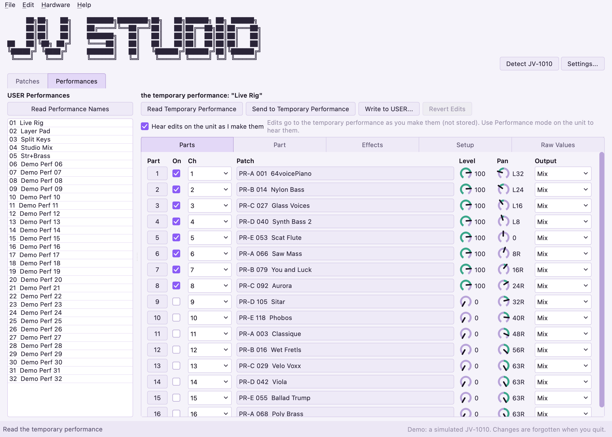

# JV Studio

[](https://github.com/martincurkovic/jv-studio/actions/workflows/build.yml)
[](https://github.com/martincurkovic/jv-studio/actions/workflows/test.yml)
[](https://www.python.org/)
[](https://doc.qt.io/qtforpython-6/)
[](https://github.com/astral-sh/uv)
[](#download--installation)
[](LICENSE)

A free, open-source **editor and librarian for the Roland JV-1010** sound module.
Built with PySide6 (Qt) and python-rtmidi. GPL-3.0-or-later.

<p align="center">
  <picture>
    <source media="(prefers-color-scheme: dark)" srcset="docs/screenshots/patch-editor-dark.png">
    
  </picture>
</p>
<p align="center">
  <picture>
    <source media="(prefers-color-scheme: dark)" srcset="docs/screenshots/performance-dark.png">
    
  </picture>
</p>

> **Status: early development.** You can read the unit's patches, edit any patch parameter on knobs and draggable envelope graphs (heard live on the unit's temporary patch, with undo), write to USER
> slots, edit performances (16 parts, effects, the patch each part plays), open and save `.syx` files, and back up and restore the whole unit. It has been tried on one JV-1010 (its author's); the performance editor has not been tried on a unit yet. **Back the unit up before
> writing to it** (File > Back Up Unit). A rhythm set (drum kit) editor is built but, like the other writes, not yet tried on a unit. A fuller librarian is still to come: see [`dev_docs/roadmap.md`](dev_docs/roadmap.md).
>
> **Hardware > System Settings...** edits the unit's global settings (tuning, MIDI receive, controller sources, effect switches) and the per-note scale tune (alternative temperaments, with the manual's three examples): changes are shown as a diff, the old settings saved to a file first, only the changes sent and read back. Not tried on a unit yet.
>
> An **audition keyboard** along the bottom (View > Audition Keyboard, Cmd/Ctrl+K) plays the unit from the mouse or the computer keyboard and chooses its patches; it has not been tried on a unit yet.
>
> **Hardware > Update Firmware... is unverified.** It checks Roland's System Update files and plays them to a unit in update mode the way a sequencer would, but it has never been tried on a real JV-1010, the unit sends no
> reply that could confirm it worked, and an interrupted or corrupted update may leave a unit unable to start. Use it at your own risk, and back the unit up first.

## Goals

- Edit the JV-1010's patches visually: knobs, draggable envelope graphs, every parameter in the manual's MIDI Implementation.
- Read and write the 128 user patches, load and save `.syx` files, and back up / restore the whole unit.
- Be careful with the hardware: edits go to the temporary patch first, every USER write saves the old patch to a file first, and nothing is written without a read-back (the one exception is the firmware updater below, which cannot read back).

## Download & Installation

Builds for each release are on the [Releases](https://github.com/martincurkovic/jv-studio/releases) page. You need a MIDI interface cabled to the JV-1010 (MIDI OUT of the interface to the unit's MIDI IN, and back); Settings > Troubleshooting has a hardware test and cabling diagrams.

**macOS** (14 or newer, Apple Silicon or Intel): open the `.dmg` and drag JV-Studio to Applications. Or install with [Homebrew](https://brew.sh): `brew install --cask martincurkovic/tap/jv-studio`. The app is not code-signed or notarized, so Gatekeeper blocks it the first time: open System Settings > Privacy & Security and click "Open Anyway", or run `xattr -dr com.apple.quarantine /Applications/JV-Studio.app`.

**Windows**: run `JV-Studio-Setup.exe`. **Linux**: unzip `JV-Studio-linux.zip` and run the `.AppImage` (it needs ALSA, which basically every desktop distribution should have).

To build it yourself, see [`BUILDING.md`](BUILDING.md).

## Try it without a unit

`uv run jv-studio --demo` starts the app on a simulated JV-1010: the factory patch names, 32 performances, a working backup and restore, no MIDI ports and no hardware. Changes are forgotten when you quit.
(`JV_STUDIO_DEMO=1` does the same; `JV_STUDIO_DEMO_INSTANT=1` removes the simulated reply time.)

## Running it

Needs [uv](https://docs.astral.sh/uv/) and Python 3.12.

```sh
uv sync
uv run jv-studio      # the app: pick your MIDI ports in Settings, then Settings > Troubleshooting
uv run pytest            # the tests
```

## The parameter table

`src/jv_studio/data/parameters.json` is generated from the JV-1010 Owner's Manual by `tools/extract_params.py` (needs `pdftotext` from
poppler). The manual is Roland's and is not in this repository; put your copy at `manual/JV-1010_OM.pdf` (git-ignored) to regenerate.

## Credits and notes

- Protocol details were cross-checked against Lars Ahlzen's MIT-licensed [jv1010tool](https://github.com/Ahlzen/jv1010tool); no code was copied.
- Wave names come from the waveform lists on [GumiElectronic](https://gumielectronic.net/?p=2312); the group table they hang on is from Roland's Owner's Manual.
- The knob and envelope-graph widgets are adapted from [AKAISDS](https://github.com/martincurkovic/AKAISDS) (same author, GPL-3.0).
- Roland and JV-1010 are trademarks of Roland Corporation. This project is not affiliated with or endorsed by Roland.
