# JV Studio Help

---

## Contents

- [MIDI Setup](#midi-setup)
- [Using a DAW at the Same Time](#using-a-daw-at-the-same-time)
- [The Main Window](#the-main-window)
- [Backing Up and Restoring the Unit](#backing-up-and-restoring-the-unit)
- [Editing Patches](#editing-patches)
- [Editing Performances](#editing-performances)
- [Editing Rhythm Sets](#editing-rhythm-sets)
- [Audition Keyboard](#audition-keyboard)
- [System Settings](#system-settings)
- [Unit Mode and GM Mode](#unit-mode-and-gm-mode)
- [Updating the Unit's Firmware](#updating-the-units-firmware)
- [Updates](#updates)
- [Troubleshooting](#troubleshooting)

---

## MIDI Setup

**1. Connect the unit**

Connect your JV-1010 to a MIDI interface. The interface's MIDI OUT goes to the JV-1010's MIDI IN, and the JV-1010's MIDI OUT goes to the interface's MIDI IN.

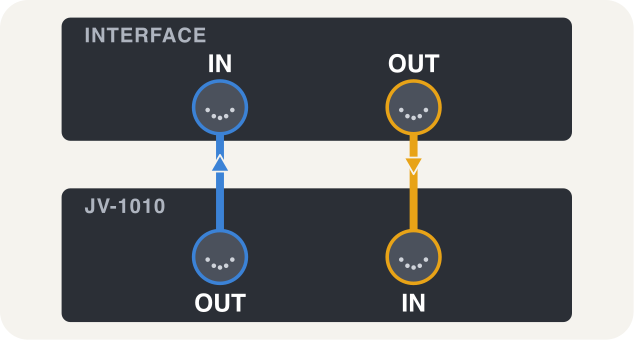

**2. Choose the ports**

Open **File > Settings...** and pick your interface as the **MIDI Input** and **MIDI Output**. There is nothing to set on the unit except that it must be switched on and in **Patch** or **Performance** mode (not GM mode, see [Unit Mode and GM Mode](#unit-mode-and-gm-mode)).

The **Appearance** settings change the theme (*System* follows your computer's light/dark mode, or choose *Light*, *Dark* or *Macintosh System 6* themes).

**3. Check it works**

Open **Settings > Troubleshooting** and press **Run Hardware Test**. It queries the unit and reads the name of its temporary patch. Nothing is written. The same check is also under **Hardware > Detect JV-1010** (Ctrl/Cmd+D).

Once the ports are open, the top right of the window shows a status pill: **Ports open** (grey), **JV-1010 · Patch mode** or **Performance mode** (green), **GM mode** (amber) or **No answer from the unit** (red). JV Studio then reads the temporary patch, the unit's current patch selection and the 128 USER patch names by itself.

---

## Using a DAW at the Same Time

You can use JV Studio and a DAW (Ableton Live, Logic, etc.) with the same MIDI interface, just ensure the DAW never routes the unit's MIDI input into a track that outputs back to it.

Why? If another program sends the unit's own replies back to it, the unit treats them as commands, and can end up changing or overwriting data you didn't mean to touch.

---

## The Main Window

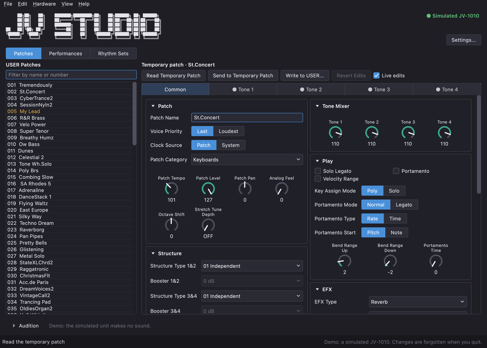

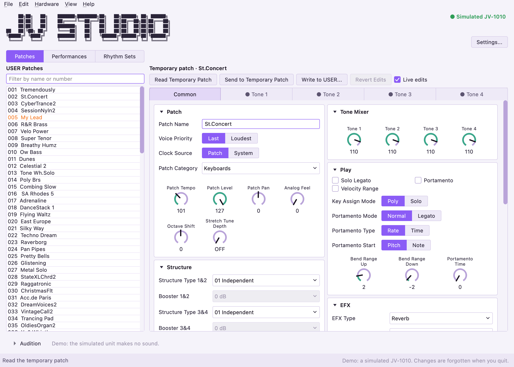

**Settings > Appearance** chooses the theme: *System* follows your computer's light or dark mode, or pick *Light*, *Dark* or *Macintosh System 6*. The System 6 theme is a homage and is not affiliated with Apple.

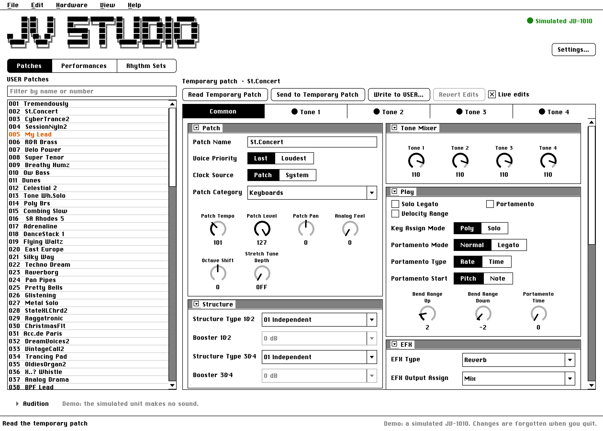

The row under the JV Studio logo switches between three editors: **Patches**, **Performances** and **Rhythm Sets**. The list on the left shows that editor's USER memory on the unit, and the editor is on the right. The Performances and Rhythm Sets load the first time you open them.

- **Double-click** a preset (or press Enter) to open it in the editor. A patch whose name differs from the factory list is highlighted, and the patch the unit is playing is marked in bold with a dot.
- The **filter box** above the list narrows it by name or number (search).
- **Right-click** a USER patch to open it, **Play on Unit**, **Rename...** (F2), **Copy To...** or **Swap With...**.
- The buttons above the editor read from and write to the unit: **Read Temporary Patch**, **Send to Temporary Patch**, **Write to USER...** and **Revert Edits**. The same actions are in the **Hardware** menu.
- **Hardware > Refresh All from Unit** (Ctrl/Cmd+Shift+R) reads all data again. The unit never announces changes made on its front panel, so use it after turning a knob or storing something on the unit.

**The temporary patch.** The unit plays one patch at a time from its *temporary patch*. Edits are sent to the temporary patch only, so you hear them but nothing is stored. Only **Write to USER...** (or a file you save) keeps them.

**Live edits.** With **Live edits** ticked, each change you finish is sent to the temporary patch at once and read back. This works while the editor shows what the unit is playing: a patch read from the unit's temporary patch, a patch sent with **Send to Temporary Patch**, or one opened by double-clicking while the audition bar has the unit on it. Otherwise the editor tells you to send the patch first, because a lone parameter would otherwise make a hybrid of two patches.

**Undo and revert.** **Edit > Undo** and **Redo** (Ctrl/Cmd+Z, Ctrl/Cmd+Shift+Z) step through your edits and go to the unit live too. **Revert Edits** goes back to the original patch. A patch with unsent edits is marked "(edited)" and is never replaced without asking.

**Files.** **File > Open Patch .syx...** and **Save Patch as .syx...** read and write standard SysEx files. A file can hold one patch or a whole bank. JV Studio lists the patches it finds, hides blank "INIT PATCH" slots on request, and repairs files whose checksums are wrong (where it safely can).

**Shortcuts.** **Help > Keyboard Shortcuts...** lists every shortcut, read from the menus themselves, plus the audition keyboard's keys and the knob and list gestures.

**Raw Values.** **View > Show Raw Values** adds a tab with every value as the unit stores it, for checking numbers.

---

## Backing Up and Restoring the Unit

**File > Back Up Unit...** reads everything the unit holds (the 128 USER patches, 32 performances, both rhythm sets and the System settings, about 1,300 requests) into one `.syx` file. It takes a few minutes and has a Cancel button. **Back up before you write anything**, and keep the file somewhere safe.

**File > Restore Unit...** writes a backup file back. You choose which sections to restore (patches, performances, rhythm sets, System settings). It checks that the file holds every block of the chosen sections before it sends anything, reads each block back, and stops at the first mismatch. System settings are unticked by default so that restoring patches never changes MIDI channels or the sound mode.

Whenever JV Studio is about to overwrite something on the unit, it first saves what is there to `~/.jv-studio/backups/` and writes nothing if that fails. The first change of a session also offers a whole-unit backup.

---

## Editing Patches

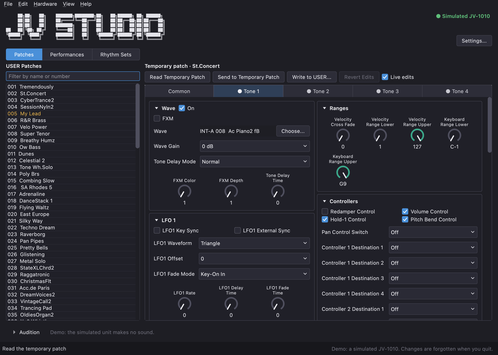

A patch has a **Common** tab and four tone tabs (**Tone 1-4**).

**Common** holds the patch name, voice priority, category, tempo and level, the **Tone Mixer** (one knob per tone), Play settings, the **Structure** types that connect each pair of tones, and the Controllers, and the patch's effects (EFX, Chorus, and Reverb & Delay).

**Each tone** has cards for its **Wave**, **Ranges** (key and velocity), **Controllers**, **LFO 1**, **LFO 2**, **Pitch**, **Filter**, **Level**, **Pan** and **Output**. A card collapses when you click its heading.

- **Knobs.** Drag to turn, hold **Shift** for fine steps, **double-click** to reset. Or click a knob once and **type** a value (for example, `C#5`, `L24`, `+12`).
- **Envelopes.** The Pitch, Filter and Level cards open with a graph of the envelope. Drag a handle to change a stage's time (left/right) and level (up/down). Double-click a handle to reset it, and press Esc during a drag to cancel it.
- **Tooltips.** Hover over any control for a short explanation and its range.

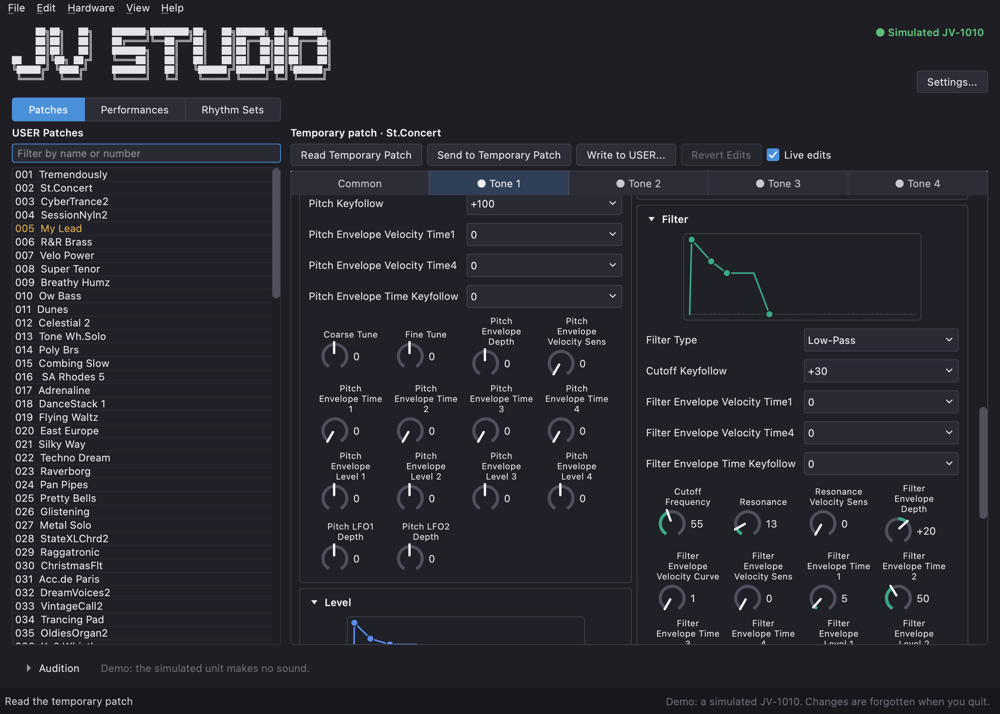

**Choosing a wave.** The Wave card shows the wave's name. **Choose...** opens a list of wave groups (the built-in INT-A and INT-B, the Session board, and any expansion board the manual lists) with a filter box. **No Wave (Tone Off)** switches the tone off, and choosing a wave for a tone that is off switches it on.

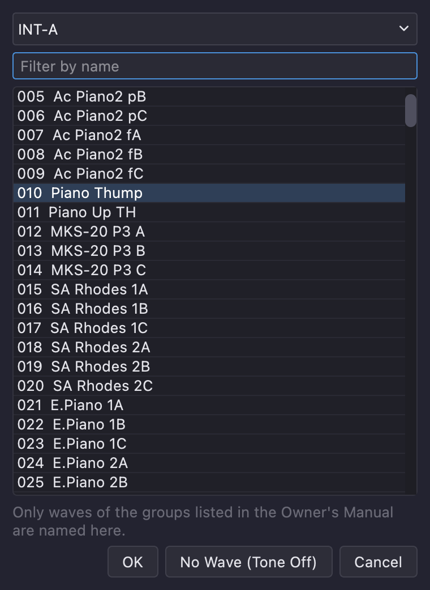

**Saving your work.** **Write to USER...** asks which USER slot to overwrite (it starts with the slot the patch came from), saves the old patch to `~/.jv-studio/backups/` first, writes the new one and reads it back to check. The slot's number and name are shown so you can see what you are replacing.

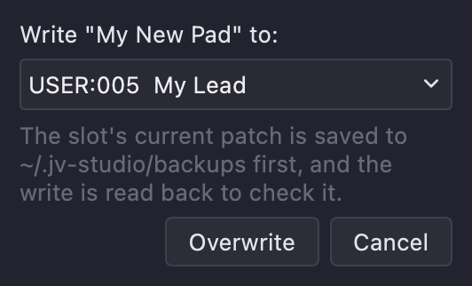

---

## Editing Performances

A performance is the unit's *Performance mode* setup: **16 parts**, each playing a patch on its own MIDI channel, with the performance's own effects.

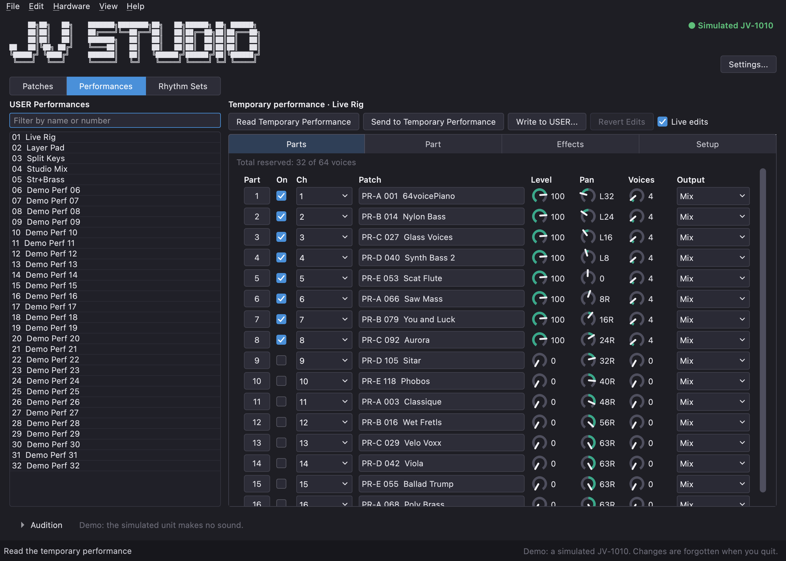

The editor has four tabs:

- **Parts** is a 16-row mixer: on/off, MIDI channel, the patch name, level, pan, output and the part's voice count. Clicking the number button on a row opens that part on the Part tab.
- **Part** edits the part chosen in the Parts tab: its patch, receive switch and MIDI channel, level, pan and tuning, output and effect sends, and key range.
- **Effects** holds the performance's own EFX, Chorus and Reverb.
- **Setup** holds the performance's name, tempo, clock source and keyboard range switch.

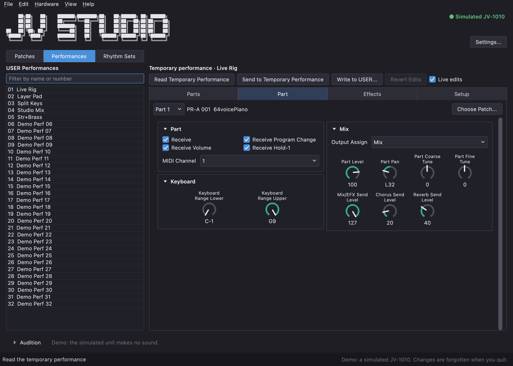

A part's patch is picked **by name** with **Choose Patch...**: choose a bank (USER, Preset A-E, Session) or one of the unit's categories, then the patch.

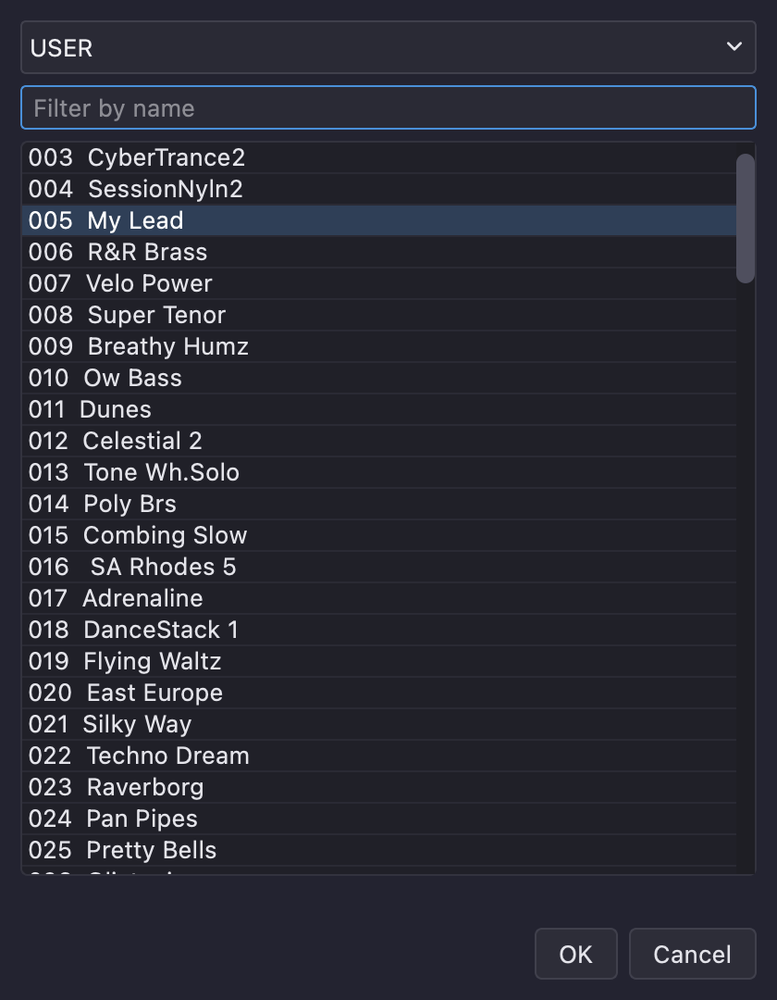

The same rules apply as for patches: **Live edits** go to the unit's temporary performance (and sound only while the unit is in Performance mode), **Send to Temporary Performance** previews a whole performance, and **Write to USER...** saves it to one of the 32 USER performances after saving the old one to `~/.jv-studio/backups/`.

---

## Editing Rhythm Sets

A rhythm set is a drum kit: each of 64 keys (35-98) has its own wave, pitch, filter, level and pan. The unit has two USER rhythm sets, and Part 10 of a performance plays one.

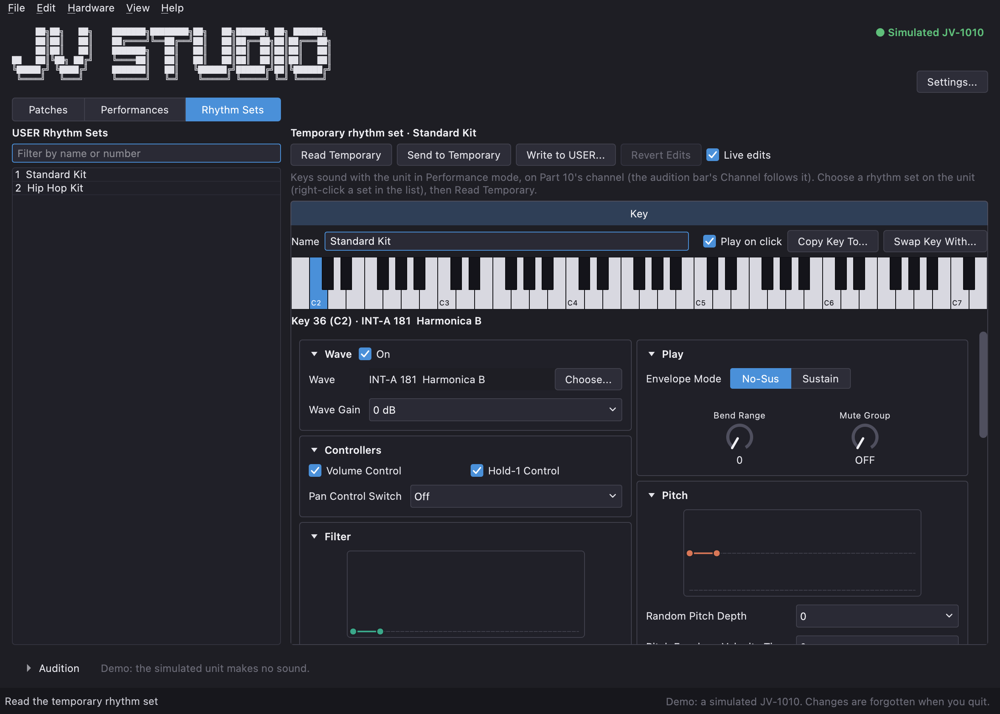

- Click or drag on the **mini keyboard** to choose a key. A key whose tone is switched off is greyed out, and hovering shows its wave. With **Play on click** ticked, a click also plays the key on the unit (on the audition bar's channel).
- The cards below edit the chosen key, with the same knobs and draggable envelopes as a patch tone. A rhythm key has no key range, LFO or structure.
- **Copy Key To...** and **Swap Key With...** copy or exchange whole keys.
- **Read Temporary**, **Send to Temporary** and **Write to USER...** work as for patches. Right-click a set in the list and choose **Choose on Unit (Part 10)** to load it on the unit before you read it.

---

## Audition Keyboard

**View > Audition Keyboard** (Ctrl/Cmd+K) shows a keyboard along the bottom of the window.

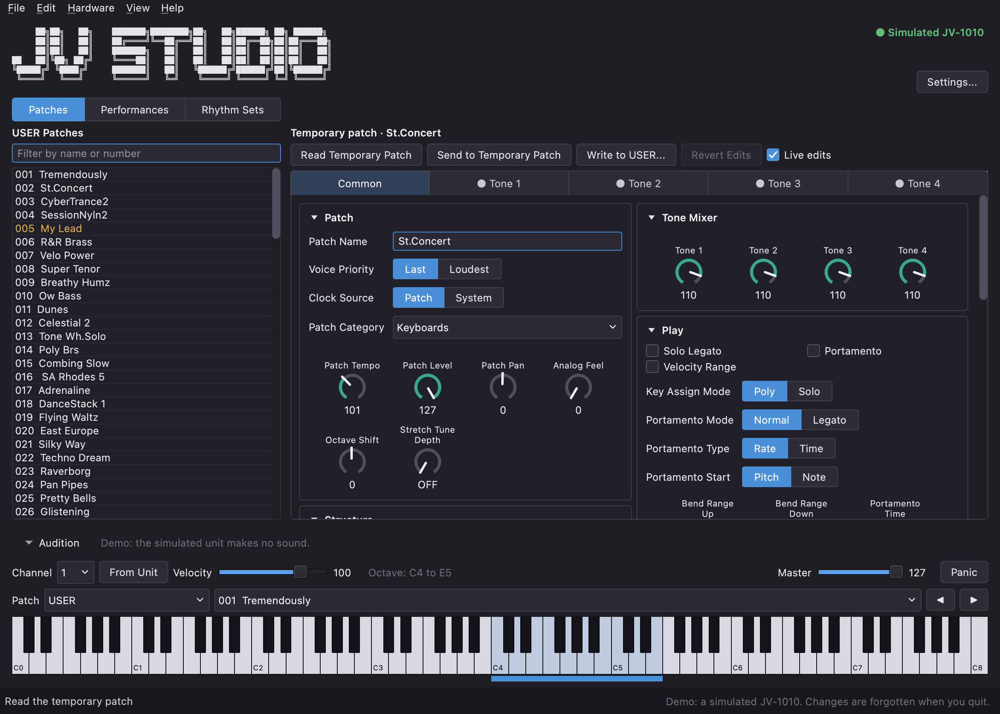

- It **always starts closed**. While it is open it uses your computer keyboard like a typical DAW's computer MIDI keyboard: **A W S E D F T G Y H U J K O L P ;** play notes, **Z / X** change octave, **C / V** change velocity, **, / .** choose the previous/next patch and **[ / ]** the previous/next bank.
- The **Channel** box is the MIDI channel notes go out on. **From Unit** reads the unit's Patch Receive Channel and tells you what would stop it playing (wrong mode, receive switches off, etc).
- The **Patch** boxes choose a bank (USER, Preset A-E, Session, or one of the unit's categories) and a patch. The editor shows the patch the unit is now playing (unless it holds unsent edits).
- **Master** is the unit's master volume and **Panic** silences stuck notes.

On the Performances tab the bar follows the part you are looking at, and on Rhythm Sets it follows Part 10.

---

## System Settings

**Hardware > System Settings...** edits the unit's global settings in its own window: master tune, effect switches, MIDI receive options, controller sources, clock source and the preview notes. The **Scale Tune** tab holds the tuning of each of the 12 notes, for each of the 16 parts and for Patch mode, with presets (Equal, Just Intonation, Arabian-type).

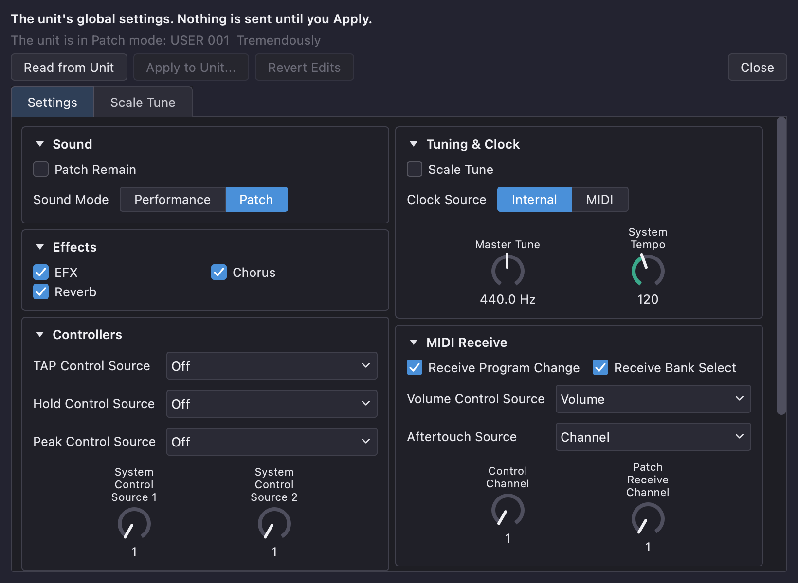

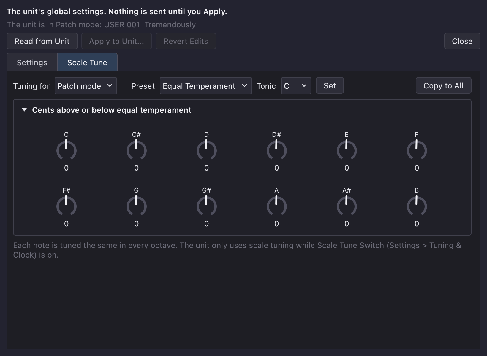

**Apply to Unit...** lists every change and what it does, asks first, saves the unit's current settings to `~/.jv-studio/backups/`, sends only what you changed and reads it back. **Restore Unit...** can use that saved file later.

---

## Unit Mode and GM Mode

The unit is in **Patch mode** (one sound at a time, what the Patches tab edits) or **Performance mode** (16 parts, what Performances and Rhythm Sets edit). The tabs never change the unit's mode by themselves. If the unit is in the other mode, the status pill turns amber and a click on it, or **Hardware > Unit Mode**, switches it (the System settings are backed up first).

**Hardware > GM System On...** puts the unit in General MIDI mode. **The unit ignores all JV Studio reads and writes in GM mode**, so use **GM System Off** (or the VALUE knob on the unit) to come back.

---

## Updating the Unit's Firmware

**Hardware > Update Firmware...** plays Roland's System Update files to a unit that is in update mode, the way a sequencer would. It is the one feature that cannot check its own result: the unit sends no reply during an update, and an interrupted update can leave a unit unable to start. **Back the unit up first**, read Roland's own instructions in the README that comes with the update, and only use an interface that has passed **Settings > Troubleshooting > Run Loopback Test** with the long messages. JV Studio checks the files and makes you confirm a checklist before it sends anything.

---

## Updates

JV Studio automatically checks for updates. If there is one, an **Update Available** window shows what is new in the release notes. Choose **View Release...** to open the download page, **Remind Me Later**, or **Skip This Version**.

**Help > Check for Updates...** (or the button in **About**) checks for updates on demand and tells you when you are up to date. The only information sent is the request for the recent releases. If you are several versions behind, the window shows the notes of every version you missed, newest first. No information about you or your unit is ever sent.

---

## Troubleshooting

- **No ports listed.** Check the cables and drivers, then reopen **File > Settings...**. If you are using a different interface, a **Run Loopback Test** (cable its MIDI OUT to its own MIDI IN) shows whether it passes long SysEx messages intact.
- **"No answer from the unit".** The input and output may be swapped, the unit may be off or in GM mode, or another program may have the ports open. Run **Run Hardware Test**.
- **Nothing happens when I edit.** Live editing needs the editor to show the unit's temporary patch. Use **Read Temporary Patch** or **Send to Temporary Patch**, and make sure the unit is in the mode that matches the tab.
- **The unit's own display differs from JV Studio.** The unit does not announce front-panel changes. Use **Hardware > Refresh All from Unit**.
- **Reporting a problem.** **Help > Open Log Folder** opens the folder holding `jv-studio.log`, which records every read, write and warning. Attach it to a bug report.
